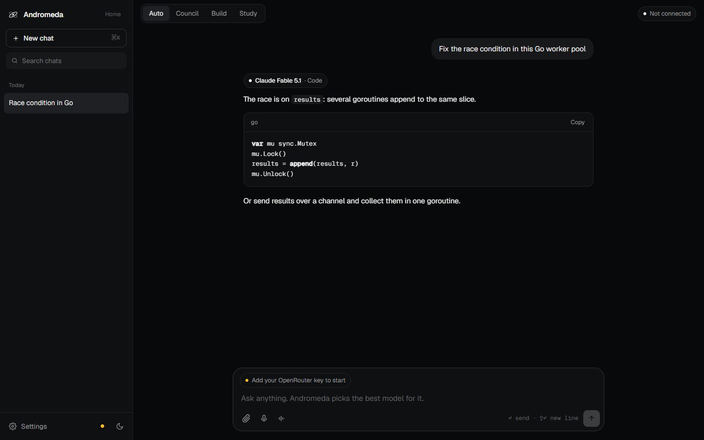
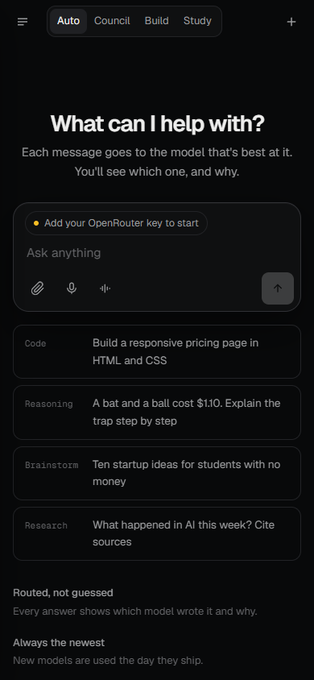

# Andromeda

**One key. Every model. Each request goes to the model that's best at it.**

There are now hundreds of strong AI models. Each lab leads at something different, and the lead changes every few weeks. People shouldn't have to track that, or pay for five subscriptions to get the best of each.

Andromeda needs one [OpenRouter](https://openrouter.ai) key. It reads what you ask and sends it to the strongest model for that kind of work: the best coder for code, the best reasoner for maths, a live-search model for anything current. Every answer shows which model handled it and what it cost.

## How routing works

Andromeda reads OpenRouter's live model list (450+ models) every time it starts. It never hardcodes model names. For each kind of task it knows which labs lead. From each lab it then picks the current flagship: the newest model in that lab's top line-up. A new model is used the day it ships, with no update to Andromeda.

| Task | Labs, in order of preference | Picked today (Best) |
|---|---|---|
| Code | Anthropic, OpenAI, Google, Moonshot, xAI… | Claude Fable 5.1 |
| Reasoning and maths | OpenAI, Google, Anthropic, xAI, DeepSeek… | GPT-6 Astra |
| Brainstorming | Anthropic, OpenAI, xAI, Google… | Claude Fable 5.1 |
| Writing | Anthropic, OpenAI, Google… | Claude Fable 5.1 |
| Research and news | Perplexity (live web search), Google… | Sonar Pro Search |
| Images | Google, OpenAI, Anthropic… | Gemini 3.1 Pro |
| Quick questions | Fast tiers from Google, OpenAI, Anthropic | Gemini 3.8 Flash |

Before you send anything, the chip above the input shows where the request will go. If the first model fails, the next one takes over. You can pin any model to any task in Settings.

**Quality** sets how much you spend. Every tier keeps the same labs and steps down each lab's line-up:

- **Best:** each lab's top model.
- **Balanced:** up to $20 per million tokens (for example Claude Opus 5.5 and GPT-6.1 Sol).
- **Economy:** up to $5 per million tokens.
- **Free:** OpenRouter's free models only, so it works with a $0 balance.

## Modes

- **Auto:** each message is routed on its own.
- **Council:** the top models from three different labs answer at the same time. A fourth model reads all three, keeps the strongest ideas, fixes what's wrong and writes one answer. You can open each model's own answer.
- **Build:** a relay with the best model for each step:
  1. One model brainstorms approaches.
  2. A second model from a different lab plans.
  3. The best builder builds it.
  4. A model from another lab reviews it and delivers the final version.
- **Study:** turn a topic or your notes into:
  - flashcards;
  - a multiple-choice quiz;
  - a typed-answer quiz that's graded with feedback;
  - a two-host podcast, 2 minutes to an hour long, that you can play or download.

## Also included

- Streaming answers with Markdown and syntax-highlighted code.
- Live preview of HTML.
- Image and file attachments.
- Voice input, and a hands-free talk mode that reads answers aloud.
- Searchable chat history and chat export.
- Reply language and tone settings.
- Light and dark themes.
- A layout designed for phones as well as desktops.

## Privacy

Andromeda is one static HTML file with no server. Your key and your chats stay in your browser's local storage. The key is only ever sent to `openrouter.ai`, and only in the `Authorization` header.

## Run it

- **Locally:** download `index.html` and open it in a browser. You can also serve the folder (`npx serve .`).
- **On GitHub Pages:** in the repo, open Settings → Pages, choose Deploy from a branch, then `main` and `/ (root)`.

Then paste an OpenRouter key from [openrouter.ai/keys](https://openrouter.ai/keys).

## Roadmap

- **Routing from real results:** score models on a public eval set for each task, and learn from which answers people keep, regrade or copy.
- **Hosted version:** sign-in, one bill, and team workspaces, with keys held server-side.
- **More inputs:** PDF and document reading, and web pages as context.
- **Sharing:** shared Council and Build runs.
- **Apps:** a browser extension (prototype exists) and mobile apps.

## License

MIT. See [LICENSE](LICENSE).
