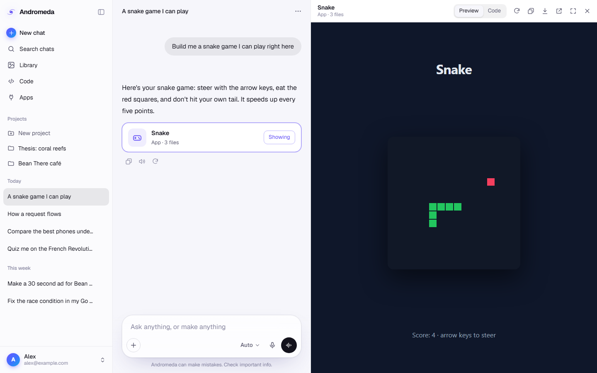

# Andromeda

**Ask anything, make anything. Each part goes to the AI model that's best at it.**

There are hundreds of strong AI models now. Each lab leads at something different, and the lead changes every few weeks. People shouldn't have to track that, set up tools, or pay for five subscriptions to get the best of each.

With Andromeda you just type. It sends each part of your request to the strongest model for that kind of work. Nothing to install and no keys: sign in and you get free credits every day.

## What it makes

- **Answers:** short questions go to one fast model; bigger ones go to a team: a lead plans the work and specialists from different labs research, reason, code and write it.
- **Videos and ads, any length:** a director plans the shots (a long film chapter by chapter) and decides how each is made: filmed by a video model where real movement matters, a picture the camera moves over (the way documentaries are made), or animated in code by the model measured best at it (motion graphics, kinetic type, diagrams, 2D characters, 3D), the way the best AI-made channels make theirs. Voice (ElevenLabs) and music (Lyria) are added, and Andromeda renders it frame by frame into a smooth, high-quality MP4 (60 fps when nothing is filmed), right in the browser. Max films every shot that isn't animated.
- **Photos, music and voiceovers.**
- **Apps and games:** built, tested and running right in the chat.
- **Files:** real PowerPoint decks (with charts and speaker notes), Excel spreadsheets with working formulas, Word documents and PDFs.
- **Study:** mind maps, flashcards, quizzes that grade your answers, two-host podcasts and interactive simulations.

## Everything the best assistants have, switched on

- **Beside the chat:** apps, games, pages and simulations open in a panel next to the conversation, with their code a click away. Long writing opens as a **canvas** you can edit, or ask Andromeda to change (all of it, or just what you've selected), with undo.
- **Projects:** chats that share instructions and files (PDFs, Word, Excel, slides, code), so Andromeda always has the background.
- **Library:** every picture, video, song, app and document Andromeda made for you, in one place.
- **A team on every answer:** the request is split into its smallest, most specific pieces ("the 5 moments a 9-year-old finds most gripping", "3 comparisons that make 'revolution' click", "that moment told as a 120-word story"), each done by the model measurably best at exactly that piece, building on each other's work. A model's pieces go to it together, in order, so a team costs one call per model rather than one per piece; when one model is the best at every piece, it writes the answer itself. Otherwise the best writer for the answer puts it together, and the model best at getting that field right checks it.
- **Works like an engineer:** runs Python and JavaScript in your browser (your spreadsheets, charts, calculations), searches and reads the web, uses your computer and apps through a small connector (asking before anything changes), and keeps long jobs going for hundreds of steps.
- **Memory** across chats (see it and delete it any time), **temporary chats** that aren't saved or remembered, and **share links** for any chat.
- **Your way:** Auto decides everything; Fast and Max change how hard it works; or pick one model yourself. Styles (Concise, Explanatory, Learning...) change how it writes. Any answer can be tried again shorter, more detailed, simpler, or with another model, and shows what the model thought before answering.
- **Capabilities:** every skill and tool is listed in Settings and on from the start; switch off what you don't want.

## Always looking things up

- A link in your message is opened and read.
- Name a library in a coding question and it pulls that library's current docs (Context7).
- Ask about something recent and it searches the web live.

## Anything, without a recipe

Nobody has to build a pipeline for what you ask. For anything Andromeda has no single way to make (a Minecraft mod, a launch with a site and an ad, a dataset and its analysis), it works like a lead engineer with a team: it works out the steps itself, hands each piece to the AI model measured best at exactly that skill (and, among models the ratings can't tell apart, the cheapest), uses its own makers for videos, pictures, music, documents and apps as tools, checks what comes back, and hands over the result, a whole project as a download if that's what it takes.

## Andromeda decides

Nothing about a request is decided by rules written in advance. The model that measurably reads requests best reads each one and decides for itself what would serve it: an answer, something built and running in the page, a picture, a film, a song, a document, a study set, work on a code project, work in your connected apps, or its own way for anything nobody thought of. If that way fails, it's told why and chooses again.

## Connect apps

Andromeda can use the same apps and tools Claude can, through MCP: Blender, Figma, Unity, your files, GitHub and thousands more. Double-click **CONNECT APPS.bat** (it needs [Node.js](https://nodejs.org)), paste the pairing code it shows into Andromeda under **Connect apps**, and list your apps in `tools/connections.json` (the same format as Claude Desktop, whose apps are picked up too; see `tools/connections.example.json`). Online MCP servers can be added by address. The connector only listens on your computer and only answers Andromeda with its pairing code.

## Everything a coding agent has, and a team on top

Andromeda's workers have what Claude Code and Codex have: files, search, the docs, the web, running Python and JavaScript, and, with your computer connected, your shell, your files and long-running jobs (each change to your computer is shown to you and asked first). On top of that they work as a team: a to-do plan you can see, helpers who look into several things in parallel, experts measured best at exactly one skill, and before anything is handed over, a different top model reviewing every change for real bugs.

Type **/** in the message box for commands (/code, /review, /test, /fix, /plan, /research, /video, /max…), and add your own: **skills** (instructions Andromeda uses by itself whenever a request fits, written here or imported from a SKILL.md link) and **commands** (prompts you use often).

What you read is always written by a top model: cheap fast models only route and plan behind the scenes, and every sum in your message is worked out exactly by code first, so an easy question is never answered wrong.

## Andromeda Code

Start a project right here in your browser, open a folder on your computer, or connect a GitHub repo, then ask for a change. Andromeda Code:

- finds and reads the files it needs and edits them precisely;
- looks up current docs and checks its own work, fixing what it broke;
- shows you a diff and, for websites, a live preview.

In a folder you can undo every change. On GitHub, nothing is committed until you click: commit, or open a pull request.

## How models are picked

By measurement, not by guesswork. Every request is first read by a fast model for exactly what it is, as narrowly as it really is ("fixing a NullPointerException in a Fabric 1.21 mixin", not "code"), and weighed as a mix of the skills [LMArena](https://lmarena.ai) measures from millions of real votes:

- **Kinds of work:** coding, maths, creative writing, instruction following, hard problems, expert questions, long requests, long conversations, getting facts right.
- **Fields:** software, medicine, law, business and finance, science, mathematics, writing and language, entertainment and sports.
- **Languages:** English, Chinese, Japanese, Korean, Spanish, French, German, Russian, Polish, and every other language.
- **Beyond chat:** web pages, React apps, a site from a screenshot, reading text in images, diagrams, homework photos, live search, documents, agentic coding.
- **The studio:** photorealistic pictures, portraits, art, cartoons, text in pictures, image editing, video from a still.

- **Agents:** finishing the job, never inventing tools or results, reliability over long command-line work, recovering from errors, following directions.

That's 101 measured skills. Every piece of a team answer is weighed on its own mix of them, and the model that scores highest on exactly that mix does it. No lab is favoured by hand. Code goes through the team too: the model measured best at code puts it together and the best code checker reviews it.

**Andromeda's own measurements.** Public leaderboards stop at a hundred skills; real work has far more ("Rust async lifetimes", "a story for a 9-year-old"). Every piece carries tags for exactly what it was, and every checked answer records whether each model's piece held up. Added up across everyone (only the tags and pass or fail, never what anyone wrote), this becomes a leaderboard for every tag, and once there's enough evidence it outweighs the general ratings.

**The best, run the way it was rated.** Many models are rated more than once, at different thinking efforts ("Claude Opus 5.5 (Max)", "GPT-5.6 Sol (xHigh)"): Andromeda runs each at the effort that scored best, with room to think that long. Each of its own features goes to the model measured best at exactly that: apps and simulations by the web-app boards, a site from a screenshot by the screenshot-to-site board, flashcards and quizzes by expertise and factual accuracy, spreadsheets by maths, decks and documents by writing and instruction following, the video director by creative writing. Live questions are answered with each lab's own web search, the way the search board rates them. In Auto, the thinking matches the work: light for an everyday question or an easy piece, more for a hard one; Max always thinks as hard as the model can. The whole conversation is always sent, and its start stays exactly the same from one message to the next (what's decided for each request goes with the newest message), so every lab rereads it from its cache at a fraction of the price: a saving that changes nothing in the answer.

The ratings come from LMArena's public dataset. The page reads the latest boards itself once a day (and `arena.json`, made by `tools/arena.mjs`, is the fallback), so a model that takes the lead is used the day it's rated. A brand-new version stands just behind its predecessor until its own ratings arrive, and takes over only if it actually measures better. If a model is busy, the next one in line takes over.

## Credits

- Everyone gets free credits that come back through the day: 100 to start, and 25 more every 6 hours until it's 100 again (the owner can change all three numbers).
- More can be bought with QRIS (and card, once it's set up).
- Andromeda only ever shows credits, never token counts.

The site runs through a small credits server on Cloudflare (`server/`) that holds the AI keys, so no one using the site ever needs or sees a key. Models are reached through WaveSpeed first (chat models, pictures, video, voice and music, with web search built in), then any OpenAI-compatible gateway, Cloudflare AI Gateway or OpenRouter. To set it up, double-click `server/SET UP SERVER.bat`.

## License

Proprietary: all rights reserved. Andromeda's code, design, name and logo may not be copied, reused or hosted without written permission. See [LICENSE](LICENSE).
